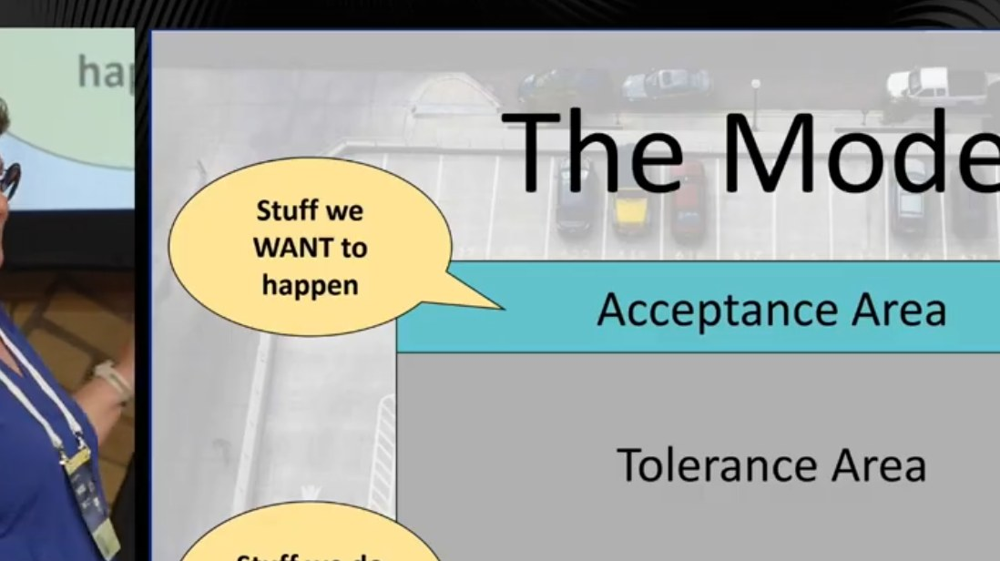

# Agile Meets Architecture 2026 (Berlin)

## How to navigate resistance by playing with the elephant in the room

*Marjoke Franken*

[YouTube](https://youtu.be/ZvamqymQH3w)

> Many software architects and other change agents often face unvoiced resistance in their organisations, often without understanding where the resistance comes from. This session introduces a surprisingly light way of examining our combined stances towards the behavior we encounter in the workplace.

Theme: **healthy boundaries**

### The model

| Area | Meaning |
|------|---------|
| **Acceptance Area** | Stuff we **WANT** to happen |
| **Tolerance Area** | Everything in between, split into 4 levels (see below) |
| **Resistance Area** | Stuff we do **NOT** want to happen |

### Acceptance-Tolerance-Model: Team Board

The [Acceptance-Tolerance-Model][atm] (by Alexander Kylburg, CC BY-SA 4.0) refines the tolerance area into 4 levels. The team board lists one column per team member: each person places a given behavior on the scale, which makes differences in stances visible.

| Level | Perceived as… | Leaves people… |
|-------|---------------|----------------|
| ❤️ **Acceptance** | appropriate, expected, agreed | satisfied, happy, *[unrecognized]* |
| 🤲 Tolerance: **Supportive** | unusual, creative, uncommon | interested, curious, surprised |
| ❓ Tolerance: **Questioning** | suspicious, questionable, strange | confused, irritated, puzzled |
| 👁️‍🗨️ Tolerance: **Ignorant** | disrespectful, ruthless, cynical | angry, annoyed, concerned |
| ⚡ Tolerance: **Endangering** | offending, threatening, frightening | desperate, hopeless, worried |
| ✋ **Resistance** | harmful, destructive, terrifying | violated, shocked, fight-or-flight |

💡 Acceptance often goes *unrecognized*: when behavior matches expectations, nobody notices it.

💡 Tolerance is not neutral: it ranges from curiosity (supportive) to fear (endangering). Unvoiced resistance often hides in the lower tolerance levels.

### Tolerance Poker

[Tolerance Poker][poker]: a card game built on the model, to examine as a team the stances each member has towards a given workplace behavior, in a light, playful way (the "elephant in the room" of the title).

### Paradox of tolerance

> "The paradox of tolerance: Unlimited tolerance must lead to the disappearance of tolerance. If we extend unlimited tolerance even to those who are intolerant, if we are not prepared to defend a tolerant society against the onslaught of the intolerant, then the tolerant will be destroyed, and tolerance with them."
>
> — Karl Popper

💡 Tolerance needs boundaries: if the tolerance area has no limit, it ends up absorbing what should be resisted.

## References

- **People**
  - Marjoke Franken (speaker)
  - Alexander Kylburg, creator of the Acceptance-Tolerance-Model
  - Karl Popper (philosopher), author of *The Open Society and Its Enemies* (1945), where the paradox of tolerance comes from
- **Concepts**
  - Acceptance / Tolerance / Resistance areas: a model for making explicit, as a group, which behaviors we want, put up with, or reject
  - [Paradox of tolerance][popper]: unlimited tolerance leads to the disappearance of tolerance
- **Tools**
  - [Acceptance-Tolerance-Model][atm]: model and team board (CC BY-SA 4.0)
  - [Tolerance Poker][poker]: card game based on the model
- **Event**
  - [Agile Meets Architecture 2026][ama], Berlin, 10–11 March 2026

[popper]: https://en.wikipedia.org/wiki/Paradox_of_tolerance
[atm]: https://www.acceptance-tolerance-model.net
[poker]: https://tolerance-poker.com/en-eu
[ama]: https://www.innoq.com/en/news/2025/08/agile-meets-architecture-2026/
