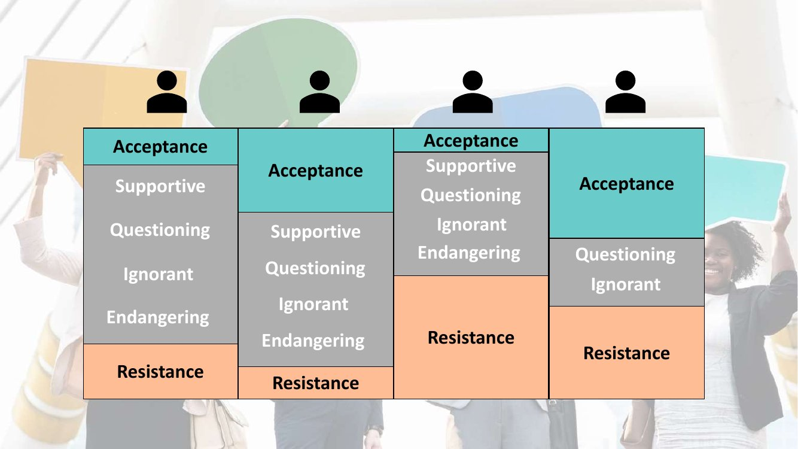

# Agile Meets Architecture 2026 (Berlin)

## How to navigate resistance by playing with the elephant in the room

*Marjoke Franken*

[YouTube](https://youtu.be/ZvamqymQH3w)

> Many software architects and other change agents often face unvoiced resistance in their organisations, often without understanding where the resistance comes from. This session introduces a surprisingly light way of examining our combined stances towards the behavior we encounter in the workplace.

Theme: **healthy boundaries**. The talk is built on the [Acceptance-Tolerance-Model][atm] by Alexander Kylburg ("How much diversity can your team stand?").

### Definitions

> **Acceptance**: "The process or fact of being received as adequate, valid, or suitable."
>
> **Tolerance**: "The ability or willingness to tolerate the existence of opinions or behaviour that one dislikes or disagrees with."
>
> — oxforddictionaries.com

### Team values vs reality

- To deal with diversity, teams write down **team values**: Respect, Trust, Openness, Commitment, Reliability, Focus, Responsibility, Passion, Be Visionary, Challenge yourself…
- And in reality? Values say nothing about what happens when someone *doesn't* live up to them.

### The model

| Area | Meaning |
|------|---------|
| **Acceptance Area** | Stuff we **WANT** to happen. (Most) team values aim here… |
| **Tolerance Area** | What about here? Everything in between, split into 4 levels |
| **Resistance Area** | Stuff we do **NOT** want to happen |

💡 Team values only describe the acceptance area. The interesting (and unspoken) part is the large tolerance area in between.

### The 6 levels

Each level applies to an **attitude or behaviour**:

| Level | Perceived as… | Leaves people… |
|-------|---------------|----------------|
| ❤️ **Acceptance** | appropriate, expected, agreed | satisfied, happy, *[unrecognized]* |
| 🤲 Tolerance: **Supportive** | unusual, creative, uncommon | interested, curious, surprised |
| ❓ Tolerance: **Questioning** | suspicious, questionable, strange | confused, irritated, puzzled |
| 👁️‍🗨️ Tolerance: **Ignorant** | disrespectful, ruthless, cynical | angry, annoyed, concerned |
| ⚡ Tolerance: **Endangering** | offending, threatening, frightening | desperate, hopeless, worried |
| ✋ **Resistance** | harmful, destructive, terrifying | violated, shocked, fight-or-flight |

💡 Acceptance often goes *unrecognized*: when behavior matches expectations, nobody notices it.

💡 Tolerance is not neutral: it ranges from curiosity (supportive) to fear (endangering). Unvoiced resistance often hides in the lower tolerance levels.

#### Common misconceptions

- Does everything that's against the rules belong in the Resistance area? → **No!**
- Does breaking the rules (like in [Shu-Ha-Ri][shuhari]) always mean Questioning the system? → **No!**

⚠️ The level depends on how the behavior is *perceived*, not on whether it complies with the rules.

### Where do the problems come from? Different people

Each person has their own profile: a different size for each area, and some levels may even be missing.

- The same behavior can be *Acceptance* for one team member and *Resistance* for another.
- Someone with a large acceptance area and no "Supportive" level jumps straight to *Questioning*; someone with a small tolerance area reaches *Resistance* quickly.

💡 People ARE different. **You need to talk!** The model gives a shared vocabulary to make these differences explicit.

### Team Board

The model comes with a printable team board: one row per level, one column per team member. Each person places a given behavior on their own scale, which makes differences in stances visible.

### Tolerance Poker

[Tolerance Poker][poker]: a card game built on the model, to examine as a team the stances each member has towards a given workplace behavior, in a light, playful way (the "elephant in the room" of the title).

### Paradox of tolerance

> "The paradox of tolerance: Unlimited tolerance must lead to the disappearance of tolerance. If we extend unlimited tolerance even to those who are intolerant, if we are not prepared to defend a tolerant society against the onslaught of the intolerant, then the tolerant will be destroyed, and tolerance with them."
>
> — Karl Popper

💡 Tolerance needs boundaries: if the tolerance area has no limit, it ends up absorbing what should be resisted.

## References

- **People**
  - Marjoke Franken (speaker)
  - Alexander Kylburg ([@alexkylburg](https://twitter.com/alexkylburg)), creator of the Acceptance-Tolerance-Model
  - Karl Popper (philosopher), author of *The Open Society and Its Enemies* (1945), where the paradox of tolerance comes from
- **Concepts**
  - Acceptance / Tolerance / Resistance areas: a model for making explicit, as a group, which behaviors we want, put up with, or reject
  - [Paradox of tolerance][popper]: unlimited tolerance leads to the disappearance of tolerance
  - [Shu-Ha-Ri][shuhari]: stages of learning (follow the rules, break the rules, transcend the rules)
- **Tools**
  - [Acceptance-Tolerance-Model][atm]: model, slide deck and team board (CC BY-SA 4.0)
  - [Tolerance Poker][poker]: card game based on the model
- **Event**
  - [Agile Meets Architecture 2026][ama], Berlin, 10–11 March 2026

[atm]: http://acceptance-tolerance-model.net
[poker]: https://tolerance-poker.com/en-eu
[popper]: https://en.wikipedia.org/wiki/Paradox_of_tolerance
[shuhari]: https://martinfowler.com/bliki/ShuHaRi.html
[ama]: https://www.innoq.com/en/news/2025/08/agile-meets-architecture-2026/
